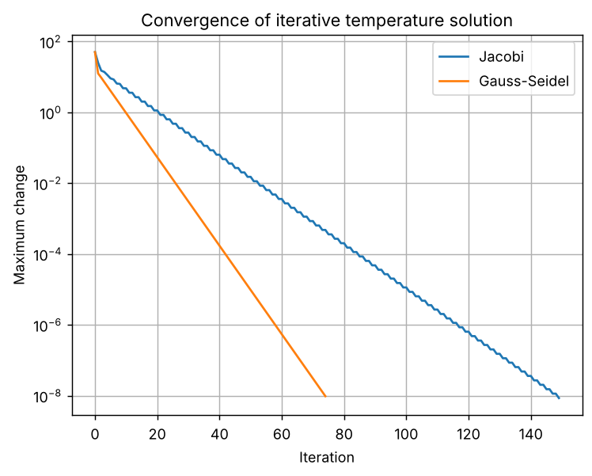
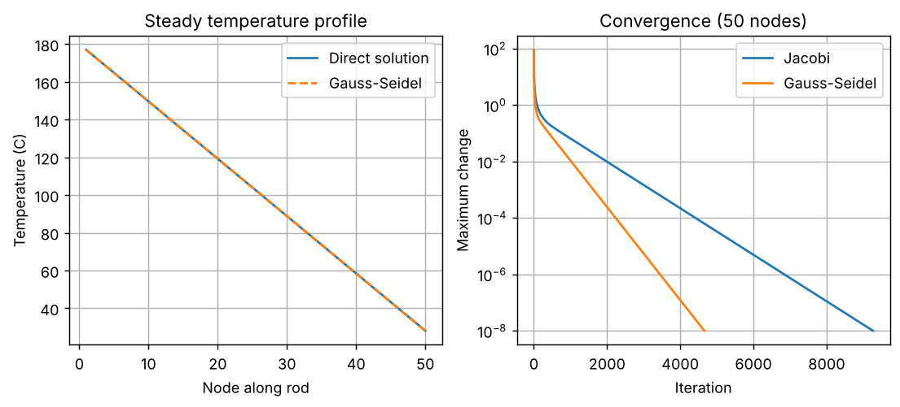

# Task 8 – Iterative Methods for Linear Systems

**Code:** [`Task_08_iterative_linear.py`](../code/Task_08_iterative_linear.py) · [`Task_08_extension.py`](../code/Task_08_extension.py)
**Output:** [`original`](../outputs/Task_08_iterative_linear_output.txt) · [`extension`](../outputs/Task_08_extension_output.txt)

## B. Inputs and mathematical operation
| Item | Value |
|---|---|
| A | 5 × 5 tridiagonal matrix with 2 on the diagonal and −1 beside it |
| b | [100, 0, 0, 0, 20] (left boundary 100 °C, right boundary 20 °C) |
| Start, tolerance | x₀ = 0, tol = 10⁻⁸, at most 500 iterations |
| Operation | Jacobi: xᵢ⁽ᵏ⁺¹⁾ = (bᵢ − Σⱼ≠ᵢ aᵢⱼxⱼ⁽ᵏ⁾)/aᵢᵢ using only old values; Gauss-Seidel uses new values as soon as they exist. Stop when the largest change < tol |

## C. Changing an input
| change | Jacobi iterations | Gauss-Seidel iterations | remark |
|---|---|---|---|
| original (100 °C, tol 10⁻⁸) | 150 | 75 | |
| left boundary 150 °C | 152 | 76 | iteration count hardly changes because the matrix, not b, controls the rate |
| tolerance 10⁻³ | 70 | 35 | fewer iterations, error 3.4×10⁻³ instead of ~3×10⁻⁸ |
| matrix [[1,3],[4,1]] (not diagonally dominant) | diverges (change 4.8×10²⁶ after 50 steps) | – | convergence not guaranteed |

## D. Meaning of the output
Both methods give temperatures 86.67, 73.33, 60.00, 46.67 and 33.33 °C, matching the direct solution to about 10⁻⁸: the temperature falls in a straight line from 100 °C at the hot end to 20 °C at the cold end.

**Graph:** the y-axis is logarithmic, so each curve is a straight line: the error shrinks by a constant factor every iteration (linear convergence). The Gauss-Seidel line is steeper and reaches 10⁻⁸ in 75 iterations versus 150 for Jacobi, so it converges about twice as fast on this problem.

## E. Related real-world case: temperature along a 50-node metal rod
**Assumptions:** a steady one-dimensional rod (for example a skewer over a charcoal jiko), 50 interior nodes, hot end 180 °C, ambient end 25 °C, no side heat loss.
**Input data:** 50 × 50 tridiagonal system built like the original one, tolerance 10⁻⁸.
**Output:** Jacobi needed **9,265** iterations and Gauss-Seidel **4,659**; their maximum errors were 3.0×10⁻⁶ and 2.6×10⁻⁶ °C. Temperatures at nodes 1, 10, 25, 40 and 50: 176.96, 149.61, 104.02, 58.43 and 28.04 °C.

**Interpretation:** the left plot is again a straight line from hot to cold. The iteration count grows rapidly with the number of nodes (5 nodes: 150; 50 nodes: 9,265) so large grids need better methods or preconditioning, but the matrix is sparse so each iteration is cheap. Gauss-Seidel again needs about half the iterations of Jacobi.
