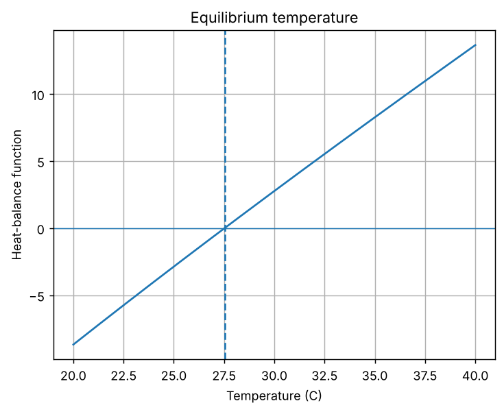
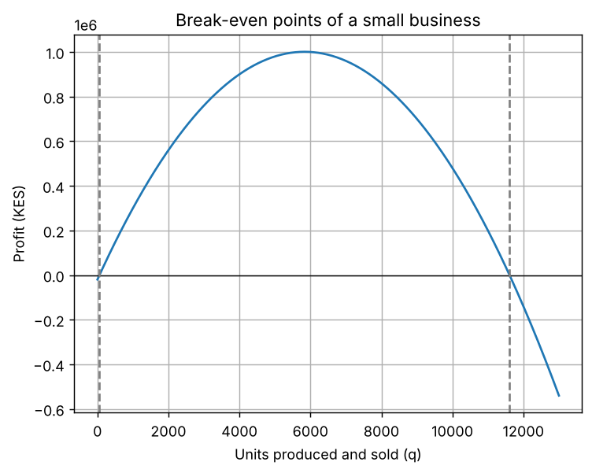

# Task 10 – Root Finding: Bisection and Fixed-Point Methods

**Code:** [`Task_10_bisection_fixed_point.py`](../code/Task_10_bisection_fixed_point.py) · [`Task_10_extension.py`](../code/Task_10_extension.py)
**Output:** [`original`](../outputs/Task_10_bisection_fixed_point_output.txt) · [`extension`](../outputs/Task_10_extension_output.txt)

## B. Inputs and mathematical operation
| Item | Value |
|---|---|
| Function | f(T) = T − 25 − 10·e^(−T/20); f(T) = 0 means heat gain equals heat loss |
| Bisection | bracket [20, 40] (f(20) < 0 < f(40)), tolerance 10⁻¹⁰: repeatedly halve the interval |
| Fixed point | T = g(T) = 25 + 10·e^(−T/20), start T₀ = 30, iterate Tₙ₊₁ = g(Tₙ) |

## C. Changing an input
| change | result |
|---|---|
| bracket [20, 40], tol 10⁻¹⁰ | root 27.525211, **38** bisection steps |
| bracket [0, 100] | same root, 40 steps (a wider bracket costs only about 2 extra halvings) |
| tolerance 10⁻³ | root 27.525024, 15 steps (less accurate, much cheaper) |
| fixed point from T₀ = 30 / 10 / 100 | same root in 13 / 14 / 14 iterations |
| bad rearrangement T = 2T − f(T) | drifts away (3261 after 10 steps): converges only if \|g′(T)\| < 1 |

## D. Meaning of the output
Both methods give an equilibrium temperature of **27.525211 °C**, the temperature at which heat gained equals heat lost. Bisection needed 38 halvings (each gains about 0.3 decimal digits) while fixed-point needed 13 iterations: faster here because |g′(T)| ≈ 0.5·e^(−T/20) ≈ 0.13 is small.

**Graph:** the curve is the heat-balance function f(T). It is negative for temperatures below about 27.5 °C and positive above it, and it crosses zero only once, which is why one bracket is enough. The dashed vertical line marks that crossing, the equilibrium temperature, 27.525 °C.

## E. Related real-world case: break-even production quantity
**Assumptions:** a small business sells q units; price falls with volume, p(q) = 500 − 0.02q KES; total cost = 20,000 + 150q + 0.01q² KES. Profit(q) = −0.03q² + 350q − 20,000.
**Input data:** brackets [1, 1000] and [5000, 20000] (profit changes sign inside each); tolerance 10⁻⁹.
**Output:** lower break-even **57.43 units** (40 bisection steps), upper break-even **11,609.24 units** (44 steps); maximum profit at q ≈ 5,833 units: KES 1,000,833. The fixed-point form q = (20000 + 0.03q²)/350 reproduced 57.4255 in 7 iterations.

**Interpretation:** the business loses money below ~58 units (fixed costs not yet covered) and above ~11,609 units (the falling price and rising unit cost overtake revenue); profit is positive between them and peaks near 5,800 units. Bisection finds both roots reliably because a sign-change bracket is guaranteed to contain one; the fixed-point form works for the lower root (derivative ≈ 0.01) but would diverge for the upper root, where |g′| > 1.
