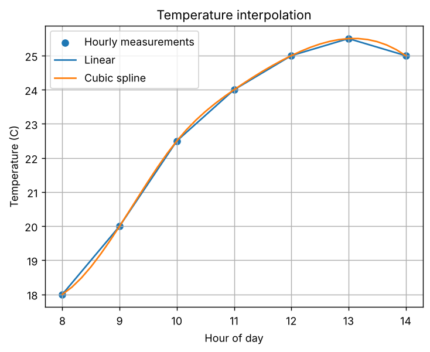
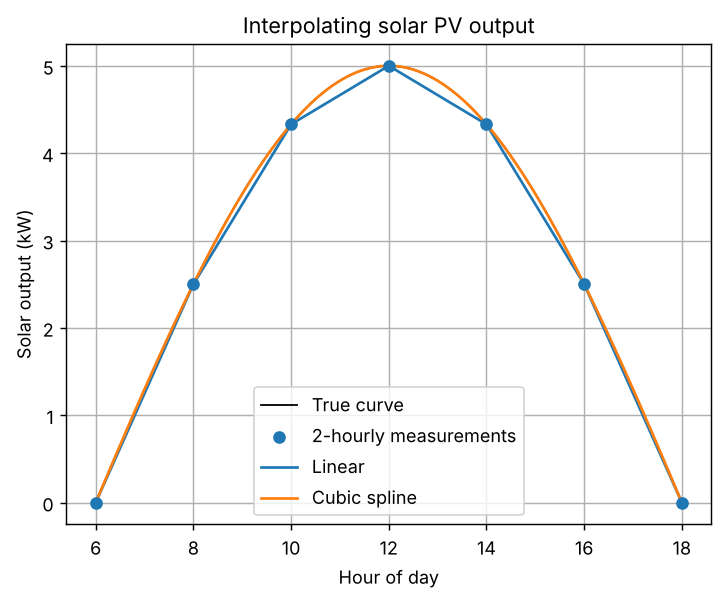

# Task 13 – Interpolation

**Code:** [`Task_13_interpolation.py`](../code/Task_13_interpolation.py) · [`Task_13_extension.py`](../code/Task_13_extension.py)
**Output:** [`original`](../outputs/Task_13_interpolation_output.txt) · [`extension`](../outputs/Task_13_extension_output.txt)

## B. Inputs and mathematical operation
| Item | Value |
|---|---|
| Data | hours 8–14 and temperatures 18.0, 20.0, 22.5, 24.0, 25.0, 25.5, 25.0 °C |
| Operations | linear interpolation (`interp1d`, straight lines between points) and a cubic spline (`CubicSpline`, smooth piecewise cubics), evaluated every 10 minutes and at 10:30 |

Note: floating-point rounding in `np.arange(8, 14 + 1/6, 1/6)` can create a final value slightly above 14, which `interp1d` rejects, so I added `np.clip(..., 8, 14)`.

## C. Changing an input
I removed the 11:00 measurement (24.0 °C) and re-estimated.

| data | linear at 10:30 | cubic at 10:30 | linear at 11:00 | cubic at 11:00 |
|---|---|---|---|---|
| all points | 23.25 | 23.36 | 24.00 | 24.00 |
| without 11:00 | 23.12 | 23.43 | 23.75 | 24.11 |

The measured value at 11:00 was 24.0. The linear estimate is 0.25 °C off and the cubic one 0.11 °C off, so the cubic spline recovers the missing point better here because the temperature curve bends.

## D. Meaning of the output
At 10:30 the linear estimate is **23.25 °C** (halfway between 22.5 and 24.0) and the cubic estimate is **23.36 °C** (it curves with the trend and sits slightly higher).

**Graph:** the dots are the hourly measurements. Both curves pass through every dot (interpolation must). The linear curve is made of straight segments with corners at each hour; the cubic spline is smooth and slightly rounds the flattening near 13:00 to 14:00.

## E. Related real-world case: gaps in solar-panel output
**Assumptions:** a 5 kW array with true output P(t) = 5·sin(π(t − 6)/12) kW from 06:00 to 18:00 (clear day). Only samples every 1, 2 or 3 hours are "measured"; the interpolants are compared with the true curve on a 1-minute grid.
**Output:**

| sampling | max error linear | max error cubic | RMSE linear | RMSE cubic |
|---|---|---|---|---|
| every 1 h | 0.0424 kW | 0.0002 kW | 0.0221 | 0.0001 |
| every 2 h | 0.1646 kW | 0.0054 kW | 0.0879 | 0.0024 |
| every 3 h | 0.3519 kW | 0.0354 kW | 0.1963 | 0.0186 |

At 12:30 with 2-hourly data the truth is 4.957 kW, linear gives 4.833 and cubic 4.957.

**Interpretation:** for a smooth curve the cubic spline is 10–200 times more accurate than linear interpolation, and error grows quickly as the sampling interval grows (linear error scales roughly with the interval squared). The graph shows the linear polyline cutting the corner at the peak. A warning: `interp1d` refuses to evaluate at 19:00 (outside the data) but `CubicSpline` silently extrapolates and gives −1.33 kW, a physically impossible value, so never trust interpolation outside the measured range.
