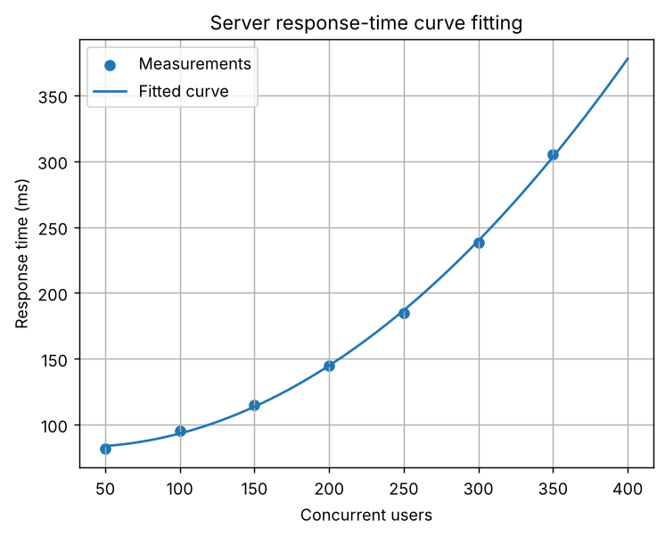
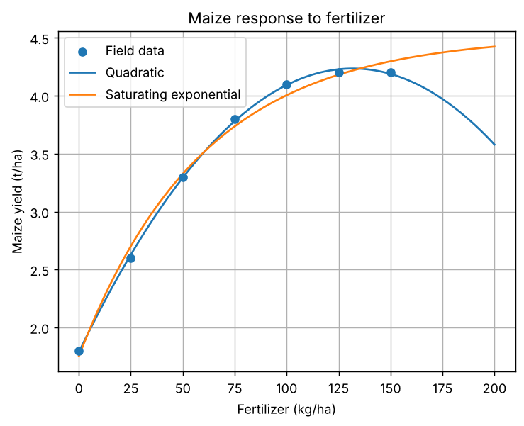

# Task 14 – Curve Fitting and Approximation

**Code:** [`Task_14_curve_fitting.py`](../code/Task_14_curve_fitting.py) · [`Task_14_extension.py`](../code/Task_14_extension.py)
**Output:** [`original`](../outputs/Task_14_curve_fitting_output.txt) · [`extension`](../outputs/Task_14_extension_output.txt)

## B. Inputs and mathematical operation
| Item | Value |
|---|---|
| Data | 7 load levels (50 … 350 users) with response times 82, 95, 115, 145, 185, 238, 305 ms |
| Model | quadratic y = a·x² + b·x + c |
| Operation | `curve_fit` chooses a, b, c to minimize Σ(yᵢ − ŷᵢ)² (least squares); quality is measured by RMSE |

## C. Changing an input
I changed the model (polynomial degree) and asked each model to predict 400 users:

| degree | RMSE | prediction at 400 users |
|---|---|---|
| 1 (line) | 18.83 ms | 312.9 ms |
| 2 (original) | 1.55 ms | 377.9 ms |
| 3 | 0.14 ms | 387.9 ms |
| 5 | 0.14 ms | 389.4 ms |

A line cannot follow the curved data (large RMSE). Higher degrees always fit the seven points better, but beyond degree 3 there is no real gain, and the extrapolated predictions begin to depend on the model chosen.

## D. Meaning of the output
The fitted curve is **y = 0.002167x² − 0.1345x + 85.00**, with RMSE 1.55 ms (typical error of about 1.5 ms on delays of 82–305 ms). The prediction for 400 users is 377.9 ms.

**Graph:** the dots are the measurements and the line is the fitted parabola, which passes very close to every point. Response time rises slowly at first and then accelerates (the upward-curving shape) as the server becomes saturated. The part of the curve from 350 to 400 users is extrapolation and is less reliable than the part inside the data.

## E. Related real-world case: maize yield vs fertilizer
**Assumptions (illustrative field-trial data):** fertilizer 0, 25, …, 150 kg/ha gives yields 1.8, 2.6, 3.3, 3.8, 4.1, 4.2, 4.2 t/ha. Two models are compared: quadratic, and a saturating exponential y = y₀ + (y_max − y₀)(1 − e^(−kx)) that levels off.
**Output:**
- quadratic: y = −0.000141x² + 0.03714x + 1.788, RMSE 0.018 t/ha, peak at 132 kg/ha (4.24 t/ha);
- saturating: y = 1.752 + (4.519 − 1.752)(1 − e^(−0.0168x)), RMSE 0.072 t/ha;
- predictions at 200 kg/ha: quadratic 3.58 t/ha, saturating 4.42 t/ha.

**Interpretation:** both curves show diminishing returns: the first 50 kg/ha adds about 1.5 t/ha, but the last 50 adds almost nothing. The quadratic fits the seven points more closely, yet outside the data it predicts a yield decline, while the saturating model predicts a plateau. They disagree strongly at 200 kg/ha, a reminder that extrapolation depends on the model, and the model should be chosen using agronomic knowledge (and more data) rather than RMSE alone. A farmer should compare the cost of extra fertilizer with the small extra yield beyond about 100 kg/ha.
