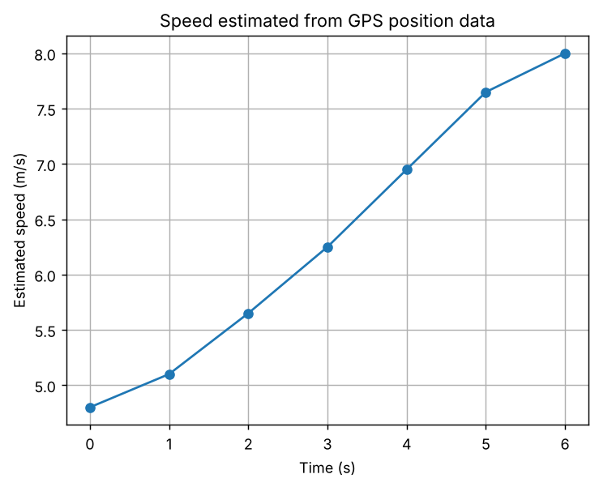
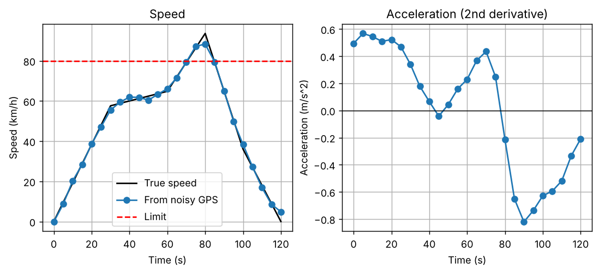

# Task 15 – Numerical Differentiation

**Code:** [`Task_15_numerical_differentiation.py`](../code/Task_15_numerical_differentiation.py) · [`Task_15_extension.py`](../code/Task_15_extension.py)
**Output:** [`original`](../outputs/Task_15_numerical_differentiation_output.txt) · [`extension`](../outputs/Task_15_extension_output.txt)

## B. Inputs and mathematical operation
| Item | Value |
|---|---|
| Data | GPS times 0–6 s (1 s apart) and positions 0.0, 4.8, 10.2, 16.1, 22.7, 30.0, 38.0 m |
| Operations | forward difference at the first point, v ≈ (x₁ − x₀)/Δt; central difference inside, v ≈ (xᵢ₊₁ − xᵢ₋₁)/(2Δt); backward difference at the last point |

## C. Changing an input
I changed the step size h for f(x) = sin x at x = 1 (true derivative cos 1 = 0.5403023059):

| h | forward error | central error |
|---|---|---|
| 10⁻¹ | 4.3×10⁻² | 9.0×10⁻⁴ |
| 10⁻² | 4.2×10⁻³ | 9.0×10⁻⁶ |
| 10⁻⁴ | 4.2×10⁻⁵ | 9.0×10⁻¹⁰ |
| 10⁻⁶ | 4.2×10⁻⁷ | 2.8×10⁻¹¹ |
| 10⁻⁸ | 3.0×10⁻⁹ | 2.6×10⁻⁹ |
| 10⁻¹⁰ | 5.9×10⁻⁸ | 5.9×10⁻⁸ |
| 10⁻¹³ | 7.3×10⁻⁴ | 1.8×10⁻⁴ |

Reducing h by 10 reduces the forward error by about 10 (first order) and the central error by about 100 (second order), so central differences are much more accurate. But for very small h the error grows again, because f(x+h) − f(x−h) subtracts nearly equal numbers (the round-off problem of Task 4). The best h is neither too large nor too small.

## D. Meaning of the output
Estimated speed rises from 4.80 m/s at t = 0 to 8.00 m/s at t = 6 s (about 17 km/h to 29 km/h): the vehicle is steadily accelerating, by roughly 0.6 m/s² (from 5.10 m/s at t = 1 to 7.65 m/s at t = 5).

**Graph:** the speed curve slopes upward throughout, which is the interpretation of "accelerating". The end points use one-sided differences, which are less accurate than the interior central differences.

## E. Related real-world case: matatu speed and acceleration with noisy GPS
**Assumptions:** position sampled every 5 s for 2 minutes; true speed profile accelerates to 16–18 m/s, bursts to 26 m/s (≈ 94 km/h) near t = 80 s, then brakes to a stop; GPS noise of 1.5 m is added (seed 3). Speed limit 80 km/h. `np.gradient` is used for speed and again for acceleration.
**Output:**
- maximum estimated speed 88.3 km/h at t = 80 s (true maximum 93.6 km/h);
- over the limit at t = 75 s and 80 s;
- maximum acceleration 0.57 m/s², maximum braking −0.82 m/s², no harsh braking (< −1.5 m/s²);
- average speed 49.5 km/h over 1.65 km.

**Interpretation:** the over-speeding burst is detected, but the estimate (88 km/h) is lower than the truth (94 km/h) because differences over a 10 s window smooth out short peaks, and GPS noise is amplified by differentiation (error of 1.5 m divided by a 10 s window still adds roughly 0.2 m/s of noise). The second derivative (right plot) is much noisier than the speed, which is why acceleration from raw GPS must be smoothed before use. This illustrates that differentiation amplifies noise, while integration (Task 16) reduces it.
