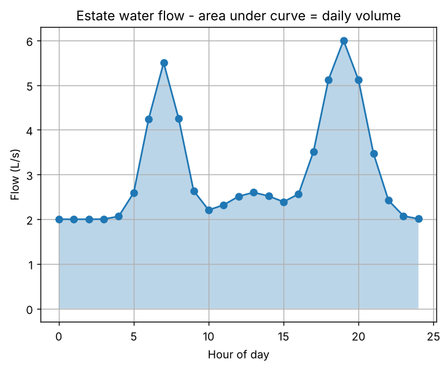

# Task 16 – Numerical Integration

**Code:** [`Task_16_numerical_integration.py`](../code/Task_16_numerical_integration.py) · [`Task_16_extension.py`](../code/Task_16_extension.py)
**Output:** [`original`](../outputs/Task_16_numerical_integration_output.txt) · [`extension`](../outputs/Task_16_extension_output.txt)

Note: `np.trapezoid` needs NumPy 2.0 or newer (older versions call it `np.trapz`).

## B. Inputs and mathematical operation
| Item | Value |
|---|---|
| Data | smart-meter power (kW) every 2 h from 0 to 12 h: 0.8, 1.0, 1.4, 1.8, 1.6, 1.2, 0.9 |
| Operation | energy E = ∫P dt, found by the trapezoidal rule (straight-line pieces) and Simpson's rule (parabolic pieces) |

## C. Changing an input
Changing the 06:00 reading from 1.8 kW to 3.0 kW raises the energy from 15.700 to **18.100 kWh** (trapezoid) and from 15.800 to **19.000 kWh** (Simpson). A bigger peak means more energy, and Simpson is more sensitive because it gives the middle points a heavier weight.
I also tested accuracy on ∫₀^π sin x dx = 2 with 3, 5, 9 and 17 points: the trapezoid errors are 4.3×10⁻¹, 1.0×10⁻¹, 2.6×10⁻², 6.4×10⁻³ and Simpson's are 9.4×10⁻², 4.6×10⁻³, 2.7×10⁻⁴, 1.7×10⁻⁵. Simpson improves much faster as points are added (error ∝ h⁴ instead of h²).

## D. Meaning of the output
The home used about **15.7–15.8 kWh** in 12 hours. The two rules differ by only 0.100 kWh (0.6 %), which indicates the estimate is reliable to about that level. Energy is the area under the power-time curve: kW × h = kWh. No graph is produced.

## E. Related real-world case: estate water volume from hourly flow readings
**Assumptions:** a flow meter records litres per second at 25 times (0 h, 1 h, …, 24 h). Demand has a base of 2 L/s with peaks at 07:00, 13:00 (small) and 19:00. Water is billed at an assumed KES 130 per m³.
**Output:** trapezoid 266.90 m³, Simpson 266.99 m³, adaptive reference (`quad`) 266.91 m³; errors 0.005 m³ and 0.087 m³. Estimated daily cost KES 34,709. Peak flow 6.00 L/s at 19:00; 26.6 % of the day's water is used between 17:00 and 21:00.

**Interpretation:** the shaded area under the curve is the daily volume (in L/s × s = litres, converted to m³). Here the trapezoidal rule beat Simpson's rule, which shows Simpson is not automatically better: for this smooth profile that starts and ends at almost the same flat level, the trapezoid rule is known to be very accurate. Both are within 0.04 % of the reference, which is far more accurate than the meter itself would be. The evening peak is what the utility must plan for.
