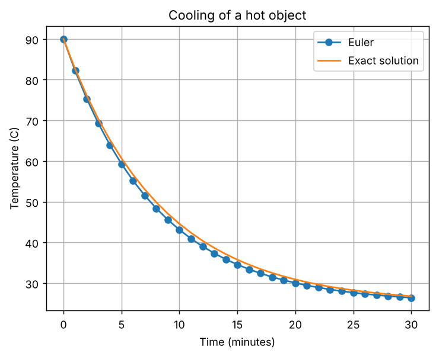
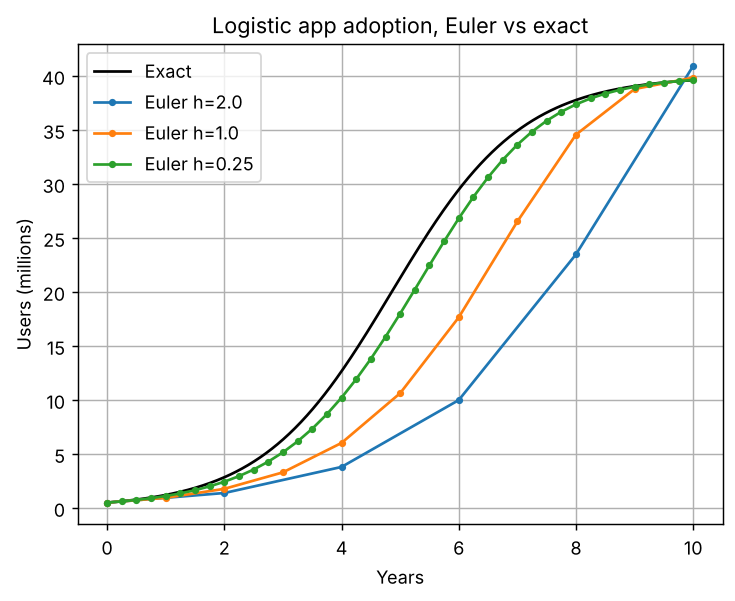

# Task 17 – Ordinary Differential Equations: Euler Method

**Code:** [`Task_17_euler_ode.py`](../code/Task_17_euler_ode.py) · [`Task_17_extension.py`](../code/Task_17_extension.py)
**Output:** [`original`](../outputs/Task_17_euler_ode_output.txt) · [`extension`](../outputs/Task_17_extension_output.txt)

## B. Inputs and mathematical operation
| Item | Value |
|---|---|
| ODE | Newton's law of cooling: dT/dt = −k(T − T_ambient) |
| Parameters | T_ambient = 25 °C, T(0) = 90 °C, k = 0.12 per min, step h = 1 min, end time 30 min |
| Operation | Euler's update Tₙ₊₁ = Tₙ + h·(−k(Tₙ − 25)); compared with the exact solution T = 25 + 65e^(−kt) |

## C. Changing an input
| step h (min) | Euler at 30 min | exact | error |
|---|---|---|---|
| 5 | 25.266 | 26.776 | 1.510 |
| 1 (original) | 26.404 | 26.776 | 0.372 |
| 0.1 | 26.738 | 26.776 | 0.0383 |
| 0.01 | 26.772 | 26.776 | 0.0038 |

The error is proportional to h (Euler is a first-order method). I also tested stability: with k = 0.12, h = 10 (hk = 1.2) the values go 90 → 12 → 27.6 → 24.5 and settle, but with h = 20 (hk = 2.4) they go 90 → −66 → 152 → −153 → 275, oscillating and growing, which is completely wrong. Euler is stable here only if h·k < 2.

## D. Meaning of the output
After 30 minutes Euler predicts 26.40 °C and the exact solution is 26.78 °C, an error of 0.37 °C.

**Graph:** the temperature falls quickly at first (large temperature difference, steep slope) and flattens as it approaches the 25 °C room temperature (an exponential decay). The Euler points lie slightly below the exact curve because each step uses the slope at the start of the step, which is steeper than the average slope over the step.

## E. Related real-world case: adoption of a new mobile app (logistic growth)
**Assumptions:** the potential market is K = 40 million users, growth rate r = 0.9 per year, P(0) = 0.5 million; dP/dt = rP(1 − P/K). Hypothetical figures.
**Output:**

| step h | users after 10 years | exact | largest error |
|---|---|---|---|
| 2 years | 40.941 M | 39.614 M | 19.5 M |
| 1 year | 39.847 M | 39.614 M | 11.8 M |
| 0.25 year | 39.632 M | 39.614 M | 3.3 M |

The exact model reaches 50 % saturation (20 million users) in 4.85 years; Euler with h = 0.01 gives 4.87 years.

**Interpretation:** adoption follows an S-curve: slow start, rapid middle, saturation near 40 million. With a coarse step (h = 2 years) Euler **overshoots** the maximum (40.9 M > 40 M) which is impossible in the real system, and mistimes the steep phase. Smaller steps fix this, which is why adaptive solvers (Task 18) are preferred.
