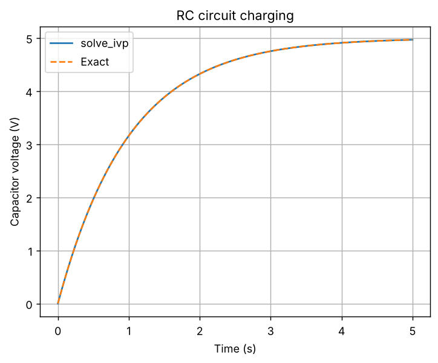
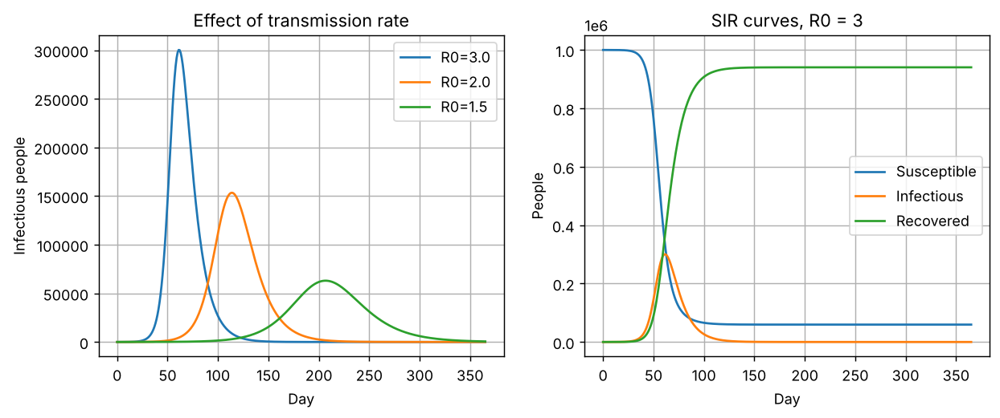

# Task 18 – Numerical Solution of ODEs Using SciPy

**Code:** [`Task_18_scipy_ode.py`](../code/Task_18_scipy_ode.py) · [`Task_18_extension.py`](../code/Task_18_extension.py)
**Output:** [`original`](../outputs/Task_18_scipy_ode_output.txt) · [`extension`](../outputs/Task_18_extension_output.txt)

## B. Inputs and mathematical operation
| Item | Value |
|---|---|
| ODE | RC charging: dV/dt = (V_s − V)/(RC) |
| Parameters | V_s = 5 V, R = 1000 Ω, C = 0.001 F (time constant τ = RC = 1 s), V(0) = 0 |
| Operation | `solve_ivp` over 0–5 s with relative tolerance 10⁻⁹ and absolute 10⁻¹¹, output at 200 times; compared with V = V_s(1 − e^(−t/RC)) |

## C. Changing an input
| R | τ = RC | V at 1 s | V at 5 s | time to reach 63 % of 5 V |
|---|---|---|---|---|
| 220 Ω | 0.22 s | 4.947 V | 5.000 V | ≈ 0.23 s |
| 1000 Ω (original) | 1.00 s | 3.161 V | 4.966 V | ≈ 1.01 s |
| 4700 Ω | 4.70 s | 0.958 V | 3.274 V | ≈ 4.70 s |

A larger resistance slows the charging in proportion. Starting the capacitor fully charged at 5 V with the supply removed (V_s = 0, R = 1 kΩ) gives a discharge: 5.00, 1.84, 0.68 and 0.03 V at 0, 1, 2 and 5 s.

## D. Meaning of the output
After 5 s (five time constants) the capacitor is at **4.9663 V**, 99.3 % of the supply. The maximum difference from the exact formula is 9.3×10⁻¹⁰ V, so the numerical solution is essentially exact.

**Graph:** the voltage rises steeply, then flattens toward 5 V (exponential approach). The dashed exact curve lies on top of the solver curve so the two cannot be told apart.

## E. Related real-world case: SIR epidemic model
**Assumptions:** population N = 1,000,000 with 10 initially infectious; recovery rate γ = 0.1 per day (10 days infectious); three transmission rates β = 0.30, 0.20 and 0.15 (reproduction number R₀ = β/γ = 3, 2, 1.5). Equations: dS/dt = −βSI/N, dI/dt = βSI/N − γI, dR/dt = γI. Illustrative, not a forecast for any real disease.
**Output:**

| R₀ | peak infectious | day of peak | infected by day 365 |
|---|---|---|---|
| 3.0 | 300,231 | 61 | 94.0 % |
| 2.0 | 153,418 | 114 | 79.7 % |
| 1.5 | 63,026 | 207 | 58.1 % |

With 40 % of people immune at the start (R₀ = 3) the peak falls to 70,740. S + I + R stays equal to N to about 10⁻⁹, a check that the solution is consistent.

**Interpretation:** the left graph shows that lowering transmission makes the epidemic peak **lower and later** ("flattening the curve"), which reduces pressure on hospitals. The right graph shows susceptible people falling as recovered people rise, with the infectious curve a short hump. Even after the outbreak ends about 6 % remain susceptible for R₀ = 3. Pre-existing immunity cuts the peak by about 76 %.
