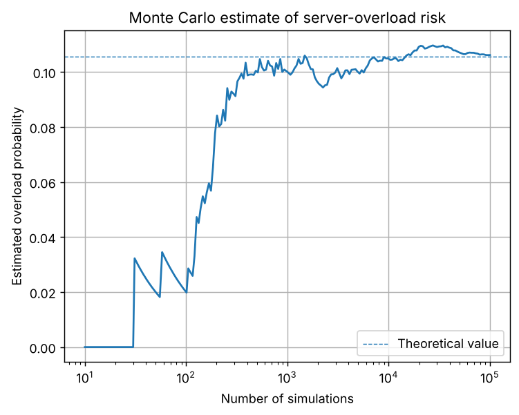
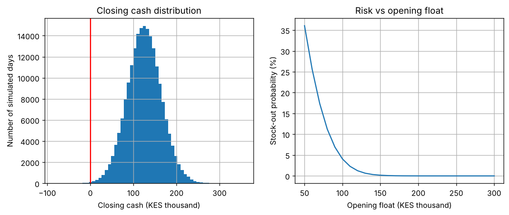

# Task 20 – Random Numbers and Monte Carlo Methods

**Code:** [`Task_20_monte_carlo.py`](../code/Task_20_monte_carlo.py) · [`Task_20_extension.py`](../code/Task_20_extension.py)
**Output:** [`original`](../outputs/Task_20_monte_carlo_output.txt) · [`extension`](../outputs/Task_20_extension_output.txt)

## B. Inputs and mathematical operation
| Item | Value |
|---|---|
| Model | server demand ~ Normal(mean 850, std 120); capacity 1000 |
| Simulation | N = 100,000 random scenarios (seed 42) |
| Operation | overload probability = (number of scenarios with demand > capacity)/N; the running estimate is plotted against N |

## C. Changing an input
| change | estimate | exact normal value | standard error |
|---|---|---|---|
| original (capacity 1000, σ 120) | 10.616 % | 10.565 % | 0.097 % |
| σ = 200 | 22.602 % | 22.663 % | 0.132 % |
| capacity 1100 | 1.912 % | 1.861 % | 0.043 % |
| N = 100, seeds 1, 2, 3 | 3 %, 8 %, 9 % | 10.565 % | about 1.7–2.9 % |

More uncertainty (larger σ) more than doubles the overload risk and extra capacity cuts it by about 80 %. With only 100 runs the answer jumps between 3 % and 9 % depending on the random seed; with 100,000 runs it is within about 0.1 %. The error shrinks like 1/√N, so 100× more samples gives about 10× less error.

## D. Meaning of the output
In 10,616 of 100,000 scenarios demand exceeded capacity, so the estimated overload probability is **10.62 %**. That is roughly one day in ten, which would be unacceptable for many services. The exact value from the normal distribution is 10.565 %, so the simulation is very close.

**Graph:** the x-axis is logarithmic. The estimate fluctuates strongly when only a few simulations have been run, then settles near the dashed theoretical line (0.1056) as N grows (law of large numbers).

## E. Related real-world case: will a mobile-money agent run out of cash?
**Assumptions (illustrative):** a random number of customers per day (Poisson, mean 60); 60 % withdraw an amount that is log-normal with median KES 2,500 (σ = 0.8 on the log scale) and 40 % deposit with median KES 3,000. The agent starts with KES 150,000 in cash; a "stock-out" is cash below zero at any time in the day.
**Input data:** 200,000 simulated days (seed 2024), tracking the cash balance after every customer.
**Output:** stock-out probability **0.166 %** (95 % interval 0.148 %–0.183 %); mean closing cash KES 125,213 and 5th percentile KES 60,031.

| opening float | stock-out probability |
|---|---|
| 100,000 | 4.07 % |
| 150,000 | 0.166 % |
| 200,000 | 0.004 % |
| 250,000 | 0.000 % |

**Interpretation:** the left histogram shows closing cash is almost always positive. The right graph shows risk falling sharply as the float increases: cutting the float from 150,000 to 100,000 multiplies the risk about 25 times, while increasing it to 200,000 almost removes it. The agent must weigh the stock-out risk against the cost of tying up more cash. As a textbook check, the quarter-circle method estimates π as 3.224, 3.1397 and 3.1421 with 1,000, 100,000 and 5,000,000 points (errors 0.082, 0.0019, 0.0005).
